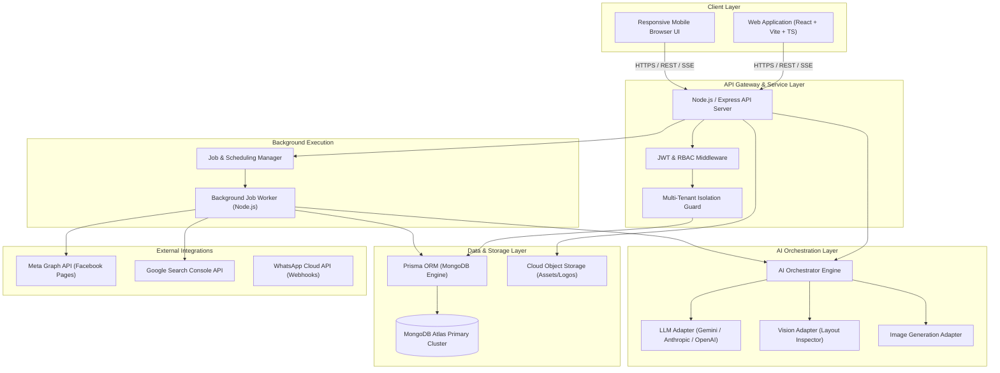
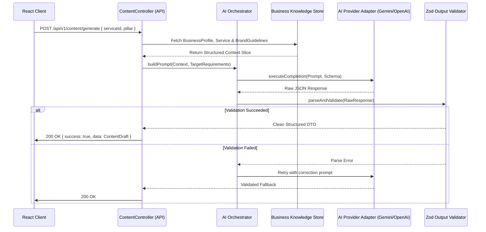

# SYSTEM ARCHITECTURE SPECIFICATION
## Veltrix AI Growth Hub

**Document Version:** 1.0.0  
**Architectural Pattern:** Modular Monorepo / Domain-Driven Architecture  
**Database:** MongoDB Atlas (via Prisma ORM)  
**Target Environment:** Node.js v22+ / React 18+ / TypeScript 5+  

---

## 1. High-Level Architecture Overview

The Veltrix AI Growth Hub is architected as an enterprise-grade, multi-tenant digital growth platform. It separates presentation, business logic, asynchronous task processing, and database persistence into distinct, loosely coupled layers.



---

## 2. Monorepo Repository Structure

The platform is organized as a clean monorepo to maximize code reuse, type safety, and maintainability across frontend, backend, and background workers.

```
Veltrix-AI/
├── apps/
│   ├── web/                          # Frontend Application (Vite + React + TS)
│   │   ├── src/
│   │   │   ├── components/           # Atomic & Composite UI Components
│   │   │   │   ├── ui/               # Button, Input, Modal, Badge, Dropdown
│   │   │   │   ├── layout/           # Sidebar, Header, PageContainer
│   │   │   │   └── shared/           # MetricCard, PostPreview, LeadBadge
│   │   │   ├── features/             # Feature-specific modules
│   │   │   │   ├── onboarding/       # Business profile wizard
│   │   │   │   ├── facebook/         # Page connection & token manager
│   │   │   │   ├── analytics/        # Performance charts & post diagnostics
│   │   │   │   ├── content/          # Copy generator & pillar strategy
│   │   │   │   ├── design-studio/    # Template recipes & visual editor
│   │   │   │   ├── crm/              # Lead pipeline & WhatsApp generator
│   │   │   │   ├── seo/              # GSC audit & keyword research
│   │   │   │   ├── automation/       # Workflow builder & webhook tester
│   │   │   │   └── calendar/         # Multi-view content scheduler
│   │   │   ├── hooks/                # Custom React hooks (useAuth, useTenancy)
│   │   │   ├── services/             # Axios/Fetch API client layer
│   │   │   ├── stores/               # Zustand state stores
│   │   │   └── types/                # UI-specific TypeScript types
│   │   ├── package.json
│   │   ├── tailwind.config.js
│   │   └── vite.config.ts
│   │
│   ├── api/                          # REST API Server (Node.js + Express + TS)
│   │   ├── src/
│   │   │   ├── modules/              # Domain-Driven Feature Modules
│   │   │   │   ├── auth/             # Authentication & session controllers
│   │   │   │   ├── organization/     # Tenancy & user management
│   │   │   │   ├── business/         # Profile, brand, services knowledge
│   │   │   │   ├── meta/             # OAuth, Page syncing, post ingestion
│   │   │   │   ├── analytics/        # Metric aggregation & reporting
│   │   │   │   ├── content/          # Content ideas, drafts & generation
│   │   │   │   ├── designs/          # Design recipes & image generation
│   │   │   │   ├── leads/            # CRM pipeline & activity logs
│   │   │   │   ├── seo/              # GSC integration & site audits
│   │   │   │   ├── automation/       # Workflow dispatchers & triggers
│   │   │   │   └── ai/               # Centralized AI prompt orchestrators
│   │   │   ├── middleware/           # Auth, TenantGuard, RateLimiter, ErrorHandler
│   │   │   ├── config/               # Env validation & global configs
│   │   │   └── server.ts             # Express entry point
│   │   └── package.json
│   │
│   └── worker/                       # Background Job & Sync Processor
│       ├── src/
│       │   ├── jobs/                 # Meta sync job, weekly report job, email dispatcher
│       │   ├── queues/               # Task scheduling & concurrency managers
│       │   └── worker.ts             # Worker runner entry point
│       └── package.json
│
├── packages/
│   ├── database/                     # Prisma schema, client & migrations
│   │   ├── prisma/
│   │   │   ├── schema.prisma         # MongoDB Prisma Schema definition
│   │   │   └── seed.ts               # Veltrix Hub initial seed script
│   │   └── index.ts                  # Exported Prisma singleton
│   │
│   ├── shared/                       # Shared utility functions & constants
│   │   ├── constants/                # Service lists, content pillars, lead stages
│   │   └── utils/                    # Crypto, formatting, date math
│   │
│   ├── types/                        # Cross-platform shared TypeScript interfaces
│   │   └── index.ts                  # DTOs, entity types, API contracts
│   │
│   └── ai-core/                      # Provider-agnostic AI orchestration adapters
│       ├── adapters/                 # GeminiAdapter, OpenAIAdapter, VisionAdapter
│       ├── prompts/                  # System prompts, role definitions, templates
│       └── validator.ts              # Zod schema output validation
│
├── docs/                             # Architecture & developer specifications
├── .env.example                      # Master environment template
├── package.json                      # Monorepo root config (npm / pnpm workspaces)
└── tsconfig.base.json                # Shared TypeScript compiler options
```

---

## 3. Data Tier: MongoDB Atlas with Prisma ORM

### 3.1 Database Engine Decision
* **Selected Engine:** MongoDB Atlas (Replica Set / Document Database).
* **ORM:** Prisma Client with `provider = "mongodb"`.
* **Primary Key Strategy:** MongoDB Native 24-character hex `ObjectId` represented as `@id @default(auto()) @map("_id") @db.ObjectId`.
* **Data Isolation:** Every top-level entity stores `organizationId: String @db.ObjectId`, indexed as a compound index with query parameters.

### 3.2 Relational Model in MongoDB
While MongoDB is non-relational, Prisma enforces schema validation and relationship mapping:
* **References (`@relation`):** Used between major collections (e.g., `Organization` $\rightarrow$ `BusinessProfile`, `SocialPage` $\rightarrow$ `SocialPost`, `Lead` $\rightarrow$ `LeadActivity`).
* **Embedded Types (`type` blocks):** Used for tightly coupled sub-documents where independent lifecycle management is unnecessary (e.g., Brand color palettes, SEO audit findings, post metrics breakdown).

---

## 4. AI Orchestration Architecture

The application implements a **Unified AI Adapter Layer** located in `packages/ai-core/`. Frontend components and API endpoints never make direct HTTP calls to AI vendors.



### 4.1 Anti-Hallucination & Evidence Boundary
* **Data Separation:** The system enforces a strict boundary between verified metrics (stored in `MetricSnapshots` directly from Meta) and AI analytical commentary.
* **Prompt Grounding:** Prompts inject empirical metrics into the context window and instruct the model: *"You must base your analysis strictly on the supplied numerical data. If a metric is missing, state it is unavailable rather than estimating it."*

---

## 5. Security & Multi-Tenancy Architecture

### 5.1 Multi-Tenant Data Isolation
Every API request is intercepted by `TenantGuard` middleware:
1. Validates JWT bearer token and extracts `userId` and active `organizationId`.
2. Verifies that the user has valid membership in `OrganizationMember` with an active status.
3. Automatically injects `where: { organizationId }` into every Prisma query.
4. Prevents cross-organization data leakage even if an ID is tampered with in request params.

### 5.2 Token Cryptography
* Social OAuth tokens (`access_token`, `refresh_token`) are encrypted at rest using **AES-256-GCM**.
* Encryption keys are managed strictly via environment variables (`TOKEN_ENCRYPTION_SECRET`), never checked into version control.

---

## 6. Background Worker & Queue Strategy

To ensure zero blocking on user requests:
* **Meta Page Sync:** Scheduled cron runs every 6 hours per connected page to fetch new posts, comments, and engagement metrics.
* **Manual Refresh:** Rate-limited to at most 1 manual sync every 15 minutes per account.
* **Worker Execution:** Handled via dedicated worker process executing jobs with exponential backoff on HTTP 429 / 5xx errors.
